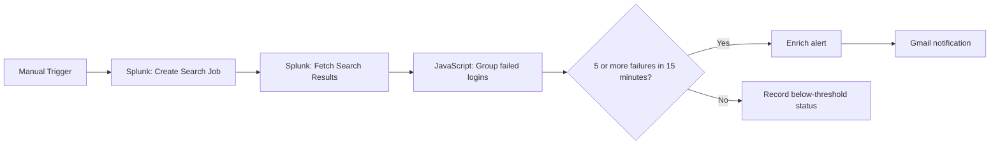

# SOC Failed-Login Investigation Automation (n8n + Splunk)

A local SOC/SOAR learning project that queries Windows Security events from Splunk, groups failed-login events, checks for repeated failures within a 15-minute window, and sends a Gmail alert when the threshold is met.

> **Project status:** The workflow's alerting path was tested previously using synthetic data and a Gmail test message. The exported Splunk query returned four historical Event ID 4625 events, and the detector summarized the highest count as two events within a 15-minute window. Live collection of newly generated Event ID 4625 events was not consistently verified in the lab. This repository documents that limitation rather than claiming a fully validated production integration.

## Architecture

## Detection logic

- Event source: Splunk index `main`, sourcetype `WinEventLog:Security`.
- Event filter: Windows Security Event ID `4625` (failed logon).
- Grouping: host, username, and source IP.
- Threshold: **5 failed logons within 15 minutes**.
- Alert route: Gmail message containing severity, account, source IP, attempt count, and a short investigation summary.
- No-alert route: records that the observed count did not meet the threshold.

The workflow's search window is currently set to `earliest=-60d` so the four historical events observed during development can be retrieved. For normal recurring operation, reduce the search window (for example, to `earliest=-15m` or a suitable overlap window) after validating the workflow's scheduling and search-job handling.

## Repository contents

- `workflow/soc-failed-login-automation.template.json` — sanitized n8n workflow template.
- `docs/SECURITY.md` — safe handling and deployment notes.
- `evidence/` — place your own redacted screenshots here (optional).

## Import and configure

1. In n8n, choose **Import from File** and select `workflow/soc-failed-login-automation.template.json`.
2. Open both **HTTP Request** nodes and replace `YOUR-SPLUNK-HOST` with the Splunk Enterprise host address reachable from the n8n container. Keep port `8089` if that is your configured Splunk management/API port.
3. Select or create a **Basic Auth** credential for both HTTP Request nodes using a dedicated Splunk account with only the permissions required to run searches. Enter the credentials inside n8n; never place passwords in this repository.
4. Open **Send a message** and select your Gmail OAuth credential. Replace `YOUR_ALERT_EMAIL@example.com` with your intended alert recipient.
5. Confirm the Splunk search returns events before testing the full workflow. The template uses the sourcetype and index observed in the lab.
6. Run the workflow manually and inspect each node's output. Test both the below-threshold path and the alert path with authorized lab data.
7. Save the workflow in n8n. It is imported **inactive** and requires configuration before use.

## Important implementation notes

- Splunk search-job creation and result retrieval are separate HTTP requests. A search job may not be ready immediately; if the results request returns empty or incomplete data, add a short wait/poll-until-complete step and validate the job status before processing results.
- The lab used a self-signed Splunk HTTPS certificate. The template therefore retains the n8n “Ignore SSL Issues” option for local lab use. This is **insecure** and should not be used in production. For a real deployment, install/trust a valid certificate and disable certificate verification bypass.
- The workflow is manually triggered. It is not an always-on monitoring service until an appropriate schedule or alert-trigger mechanism is configured and tested.
- The template is a sanitized starting point, not a production-ready SOAR deployment.

## Validation record

During development:
- Synthetic test with five failed-login records inside the 15-minute window produced `alert: true` and successfully sent a Gmail test alert.
- The historical Splunk search returned four Event ID 4625 events.
- The detector output for the available historical records was `failed_attempts: 2`, `threshold: 5`, `window_minutes: 15`, `alert: false`.
- Newly generated local Windows Event ID 4625 events were visible in Windows Event Viewer/PowerShell but were not consistently appearing in Splunk during the troubleshooting session.
## Evidence screenshots

The repository includes screenshots documenting the n8n workflow, detection results, Splunk searches, and PowerShell investigation steps.

Evidence is organised by tool:

- `evidence/n8n/` — workflow overview, detection output, and workflow execution.
- `evidence/splunk/` — historical Windows Event ID 4625 results and event-code distribution.
- `evidence/powershell/` — Windows Security event checks and troubleshooting evidence.

Screenshots are provided for transparency and reproducibility. Some screenshots reflect troubleshooting during development; they should not be interpreted as proof that live Splunk-to-n8n alerting is fully operational.

**Security requirements:** Do not publish passwords, OAuth tokens, API keys, session cookies, personal account details, or unredacted credential settings. Review screenshots and workflow exports before publishing.
